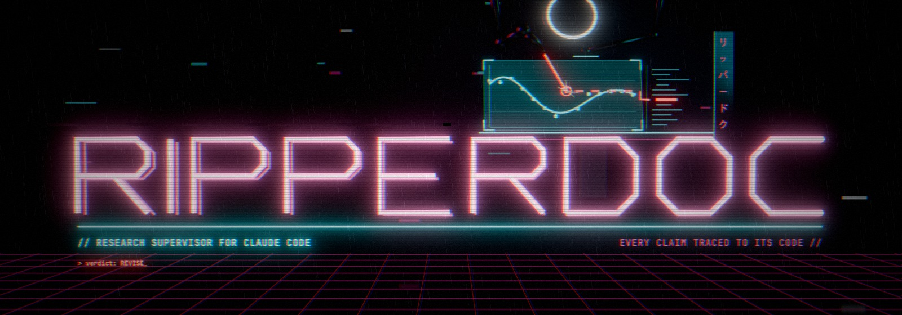

<p align="center"></p>

# Ripperdoc

A research supervisor for Claude Code. Ripperdoc questions results and experiment designs before anyone trusts them: it verifies 1 to 3 key claims itself, mainly by tracing each number to the code line and equation that produce it and judging whether they are right (quick recomputes from saved outputs are allowed; pipeline reruns only when you allow them), returns a verdict (accept / revise / reject), prioritized issues, a do / revise / discard action list, and a schema-validated JSON review. It never edits the work it reviews.

## What is in here

| Path | What |
|---|---|
| `SKILL.md` | The procedure, rules and output format. Single source of truth. |
| `agents/ripperdoc.md` | Subagent template (thin: reads `SKILL.md`; tools, guard hook). |
| `skills/experiment-review/SKILL.md` | Companion skill: `/code-review` on the experiment's code, then Ripperdoc with those findings. |
| `bin/sandbox-run` | Runs code with the whole filesystem read-only (bubblewrap on Linux, sandbox-exec on macOS), no network, one writable run dir, 5 min default timeout. |
| `bin/merge_reviews.py` | Drafts the merged review from two ensemble members, carrying every blocking issue. |
| `bin/validate.py` | Validates reviews and dossiers against `schema/` plus consistency rules (stdlib only). |
| `bin/render_dossier.py` | Renders `dossier.json` to `DOSSIER.md`. |
| `hooks/guard.py` | PreToolUse hook for the subagent: writes only in `ripperdoc_reviews/` or scratch, code runs only sandboxed, read-only git. |
| `packs/` | Domain packs (`research-core`, `physics`, `ml`): per domain, what tracing to the equation means, quick recompute recipes and a checklist. Ripperdoc picks them per review; check them with `bin/validate.py packs`. |
| `schema/` | `review.schema.json`, `dossier.schema.json`, `pack.schema.json`. |
| `tests/` | Unit tests for the guard and the validator: `python3 -m unittest discover -s tests`. |
| `evals/` | Planted-flaw cases, answer key and scorer that measure whether Ripperdoc catches flaws (see `evals/README.md`). |

## Install

Requirements: Claude Code, `python3`, and for running code: `bwrap` (bubblewrap) on Linux, or the built-in `sandbox-exec` on macOS. Without either, Ripperdoc still traces but cannot recompute.

```bash
git clone https://github.com/gbareas/ripperdoc && cd ripperdoc && ./install.sh
```

`install.sh` writes `~/.claude/agents/ripperdoc.md` and `~/.claude/skills/experiment-review/SKILL.md` with this checkout's path filled in. Edit files here, then rerun it. Restart Claude Code afterwards.

## Use

From any project folder in Claude Code:

- **Review a result**: "Use ripperdoc to review <result / file / experiment>. Goal: ... Claim: ..."
- **Allow a rerun** (otherwise it never reruns pipelines): add "Rerun of <script> allowed, max <N> min".
- **After an experiment finishes**: "Run experiment-review on <experiment>" (code review first, then Ripperdoc).
- **Only learn the project**: "Have ripperdoc onboard this project" (builds the dossier from your documents, no review).
- **Literature search** (off by default): "Have ripperdoc search the literature for this project", or add "with literature search" to a review request.
- **Second reviewer**: `experiment-review` runs two Ripperdoc reviews on different models and merges them (blocking issues are a union, never averaged). Say "single reviewer" to skip it.
- **Next round** after fixes: ask again with the same work; Ripperdoc finds its earlier report.

To make the post-experiment review automatic in a project, add to its `CLAUDE.md`:

> When an experiment, analysis, evaluation or simulation run finishes, run the `experiment-review` skill (code review, then the `ripperdoc` agent) before its numbers go into a findings document, figure or paper. Report the verdict and actions, then wait for the user before fixing or rerunning anything.

Everything Ripperdoc writes goes to `ripperdoc_reviews/` at the project root: `dossier.json` + `DOSSIER.md`, one report per review (`<date>_<slug>_r<round>.md`), code-review files, and `NOTES.md`. Decide per project whether to commit that folder.

## Credits

The reasoning-then-JSON output, the round-capped keep/revert loop, the experiment log as ground truth and the reviewer ensemble are adapted from google-research/paper-orchestra (Apache License 2.0).
